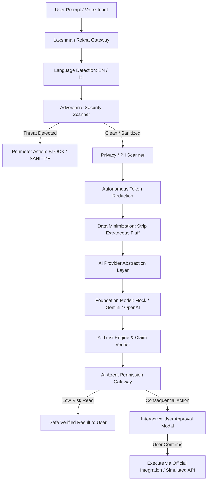

# LAKSHMAN REKHA AI (लक्ष्मण रेखा AI)
> **"Your Digital Boundary for Safe AI"**  
> *"Lakshman Rekha AI gives users control over what AI is allowed to KNOW, REMEMBER, PROCESS, and DO."*

---

## 🛡️ Executive Summary & Product Positioning

**Lakshman Rekha AI** is an enterprise-grade AI Security, Privacy & Trust Gateway designed to provide a protective, inspectable boundary around foundation model interactions. 

Inspired by the cultural concept of the **"Lakshman Rekha"**—an impassable protective boundary that prevents threats from entering and private assets from crossing unshielded—the product serves as a **zero-trust guardrail** between users, external AI models (OpenAI, Gemini, Anthropic), and autonomous AI agents.

> **Important Positioning Note**:  
> Lakshman Rekha AI is **not** a religious application, nor does it make theological claims. It respectfully utilizes the boundary metaphor to illustrate how modern AI security requires clear perimeters. We do not claim that AI is infallible or that privacy is an absolute guarantee; instead, we provide transparent controls, local tokenization, claim verification, and human-in-the-loop authorization.

---

## 🌟 The Four Core Questions Lakshman Rekha Answers

```
                 ┌──────────────────────────────────────────────────────────┐
                 │                THE LAKSHMAN REKHA PERIMETER              │
                 │                                                          │
USER ───────────►│  🛡️  AI SECURITY, PRIVACY & TRUST GATEWAY                 │
                 │                                                          │
                 │  1. WHAT IS AI RECEIVING?   ➔ Sanitized & Minimized      │
                 │  2. WHAT CAN AI KNOW?       ➔ Only What You Permit       │
                 │  3. WHAT CAN AI REMEMBER?   ➔ Ephemeral / Opt-in Memory  │
                 │  4. WHAT CAN AI DO?         ➔ Zero Consequential Action  │
                 │                               Without Human Consent      │
                 └──────────────────────────────────────────────────────────┘
```

1. **What is AI receiving?** All prompts pass through language detection, injection scans, PII scrubbing, and contextual data minimization before external transmission.
2. **What is AI allowed to know?** Raw secrets, API keys, passwords, and Indian government IDs (Aadhaar, PAN, UPI) are tokenized locally into `[API_KEY]`, `[GOV_ID]`, `[PERSON]`.
3. **What is AI allowed to remember?** Memory accretions require explicit user authorization cards (`[ALLOW ONCE]`, `[ALWAYS ALLOW]`, `[DON'T SAVE]`). Private Life Mode and Incognito sessions enforce zero-retention.
4. **What is AI allowed to do?** AI agents cannot silently send WhatsApp messages, delete files, or execute financial transactions. Consequential actions trigger an interactive authorization card.

---

## 🚀 Key Feature Matrix

| Feature | Description | Status |
| :--- | :--- | :---: |
| **Adversarial Security Scanner** | Real-time detection of prompt injections, jailbreaks (DAN), and system prompt leaks in **English and Hindi** | ✅ **Active** |
| **Privacy & PII Shield** | Auto-detection of Names, Emails, Phone numbers, Indian Aadhaar (`1234 5678 9012`), PAN cards, UPI IDs, API keys, and Passwords | ✅ **Active** |
| **Autonomous Token Redaction** | Transforms raw secrets into `[API_KEY]`, `[PASSWORD]`, `[EMAIL]` without exposing values in logs | ✅ **Active** |
| **Data Minimization Engine** | Detects and strips irrelevant personal preambles (name, location, identity) before sending queries to LLMs | ✅ **Active** |
| **Private Life Mode 🔒** | Dedicated sandbox for emotional, relationship, or career inquiries with zero memory accretion | ✅ **Active** |
| **Incognito AI Session** | Ephemeral browser session with banner (`🕶 PRIVATE SESSION ACTIVE`) and one-click memory wipe | ✅ **Active** |
| **Bilingual Localization** | Full English & Hindi UI translation and multilingual threat detection | ✅ **Active** |
| **Voice Assistant** | Web Speech API speech-to-text, push-to-talk, and text-to-speech with English & Hindi voices | ✅ **Active** |
| **AI Trust Engine** | Analyzes AI responses, calculates a transparent Trust Score (e.g., 82/100), and flags potential hallucinations | ✅ **Active** |
| **Ground Truth Claim Verifier** | Extracts individual factual claims, matches historical consensus, and links corroborating evidence | ✅ **Active** |
| **Code Security Scanner** | Static analysis of AI-generated code for hardcoded keys, SQL injection, `eval()`, and generates hardened code | ✅ **Active** |
| **AI Agent Permission Gateway** | Enforces LOW RISK, MEDIUM RISK, HIGH RISK, and BLOCKED policies on autonomous agents | ✅ **Active** |
| **Secure WhatsApp Gateway** | Official API abstraction with contact policies (Mom, Friends, Work, Unknown) and interactive DEMO mode | ✅ **Active** |
| **My Privacy Vault** | User control over personal info, masked secrets (`sk-••••••••••91ab`), and approved memory entries | ✅ **Active** |
| **Tamper-Evident Audit Trail** | Chronological security activity log with severity filters and exportable JSON | ✅ **Active** |
| **Hackathon Guided Demo** | 7-step one-click guided demonstration tour designed for rapid judging evaluation | ✅ **Active** |

---

## 🏗️ Architecture & Core Product Flow



---

## 📁 Repository Structure

```
lakshman-rekha-ai/
├── assets/
│   ├── logo.png             # Official Lakshman Rekha brand logo asset
│   └── logo.jpg
├── css/
│   ├── main.css             # Design tokens, color system, typography, animations
│   ├── components.css       # Cards, boundary widget, modals, scorebars, chat
│   └── responsive.css       # Mobile bottom navigation, accessibility modes
├── js/
│   ├── i18n/
│   │   ├── en.js            # English translations
│   │   └── hi.js            # Hindi translations (हिंदी)
│   ├── services/
│   │   ├── securityScanner.js       # Prompt injection, jailbreak, malicious payload detector
│   │   ├── privacyScanner.js        # PII, Aadhaar, PAN, UPI, passwords, API keys
│   │   ├── redactionEngine.js       # Auto-redaction into [TOKENS] & secret masking
│   │   ├── dataMinimizer.js         # Context stripper & task query extractor
│   │   ├── trustEngine.js           # Hallucination assessment & claim verification
│   │   ├── agentPermissionEngine.js # Action risk tiering & permission gatekeeper
│   │   ├── messageSecurityEngine.js # WhatsApp message verification & contact policy
│   │   ├── codeSecurityEngine.js    # Static analysis & hardened code refactorer
│   │   ├── voiceAssistant.js        # Speech-to-text & TTS with English/Hindi voices
│   │   └── aiProvider.js            # Multi-provider layer (Mock, Gemini, OpenAI)
│   ├── state/
│   │   └── store.js                 # Unified reactive application state
│   ├── views/
│   │   ├── landingView.js           # Brand hero, visual boundary, core pillars
│   │   ├── dashboardView.js         # Trust & Safety telemetry, active boundary card
│   │   ├── chatView.js              # Secure AI chat, voice I/O, private life toggle
│   │   ├── securityScannerView.js   # Adversarial sandbox with EN/HI presets
│   │   ├── privacyShieldView.js     # PII detection & "Where Your Data Goes" flow
│   │   ├── trustCenterView.js       # Factual claim verification & source evidence
│   │   ├── codeSecurityView.js      # Code security audit & safe rewrite generator
│   │   ├── agentGatewayView.js      # AI agent permission matrix & action triggers
│   │   ├── whatsappView.js          # Protected WhatsApp dispatch & contact policies
│   │   ├── privateSessionsView.js   # Ephemeral chat & memory purge
│   │   ├── privacyVaultView.js      # Sovereign data control & JSON export
│   │   ├── activityLogView.js       # Non-repudiable audit ledger
│   │   ├── settingsView.js          # Preferences, strictness, and 4-phase roadmap
│   │   └── demoTourModal.js         # 7-step interactive hackathon demo tour
│   └── app.js                       # Master router, global events, and UI lifecycle
├── tests/
│   └── test_security.py             # Automated unit tests for injection, PII, redaction
├── schema.sql                       # Complete PostgreSQL / Supabase database schema
├── .env.example                     # Environment configuration template
├── server.py                        # Local Python server with CORS & custom headers
├── index.html                       # Application HTML5 entry point
└── README.md                        # Master product documentation
```

---

## 🛠️ Setup & Running Instructions

### Prerequisites
- Python 3.8+ (Works seamlessly with Python 3.13)
- Modern web browser (Chrome, Edge, Firefox, Safari)

### Quick Start (Zero External Dependencies Required)

1. **Clone or Navigate to the Project**:
   ```bash
   cd lakshman-rekha-ai
   ```

2. **Run Automated Test Suite**:
   ```bash
   python tests/test_security.py
   ```
   *Expected output: `Ran 6 tests in 0.001s ... OK`*

3. **Launch the Local Development Server**:
   ```bash
   python server.py 8000
   ```

4. **Open in Browser**:
   Visit [http://localhost:8000](http://localhost:8000)

---

## 🎬 2-3 Minute Hackathon Demo Walkthrough

Click the glowing **"Demo Mode"** button in the top navigation header to execute any of the 7 pre-configured scenarios with one click:

- **Scenario 1: Prompt Injection Neutralization (English & Hindi)**  
  Click "Run Demo" on Scenario 1. Observe how Lakshman Rekha intercepts the prompt injection attempt, highlights the critical risk, and prevents override of system instructions.
- **Scenario 2: PII & Secret Leakage Prevention**  
  Click Scenario 2. The input with a personal email, phone number, and OpenAI `sk-...` API key is automatically tokenized into `[PERSON]`, `[EMAIL]`, and `[API_KEY]`.
- **Scenario 3: Private Life Mode 🔒**  
  Toggles Private Life Mode. The user can discuss personal or emotional dilemmas knowing conversation buffers are isolated from persistent application memory.
- **Scenario 4: Ground Truth AI Claim Verification**  
  Scans an AI output paragraph, isolating verified historical facts (Eiffel Tower in 1889) from uncorroborated assertions.
- **Scenario 5: AI Agent WhatsApp Authorization Gateway**  
  Simulates an agent attempting to dispatch a WhatsApp message. Lakshman Rekha halts the action and renders an interactive human-in-the-loop authorization card with `[DENY]`, `[EDIT]`, and `[ALLOW ONCE]`.
- **Scenario 6: Destructive Action Hard Block**  
  Simulates an agent attempting to execute a destructive `delete_file` command. Lakshman Rekha halts execution with a permanent critical block.
- **Scenario 7: Code Security Scanner**  
  Analyzes vulnerable Python code containing hardcoded credentials and SQL injection, and generates a clean, parameterized version.

---

## 🛡️ Privacy & Security Architectural Guarantees

1. **No Raw Secrets in Logs**: All API keys, passwords, and government IDs are masked into tokens (`sk-••••••••••91ab`) prior to logging.
2. **Local Pre-Processing**: Threat detection and redaction occur *before* outbound network packets reach any third-party model.
3. **No Unofficial Scraping**: WhatsApp integration strictly adheres to authorized API abstractions; demo mode provides authentic simulations without violating platform terms of service.
4. **Ephemerality by Design**: Private life conversations and incognito voice transcripts are cryptographically purged upon session termination.

---

## 🗺️ Future Roadmap & Enterprise Governance

- **Phase 1 (Delivered)**: Personal AI Security, Bilingual Injection Filters, PII Redaction, Ephemeral Sessions, Voice Assistant.
- **Phase 2 (Delivered)**: AI Agent Permission Gateway, WhatsApp Dispatch Authorization, Static Code Audit.
- **Phase 3 (Q4 2026)**: Enterprise Governance, Shadow AI Discovery, Centralized Role-Based Access Controls (RBAC), and Automated SOC2/GDPR Compliance Export.
- **Phase 4 (2027)**: Cross-Platform Mesh, Browser Extension Proxy, Slack/Teams Bot Perimeters, and On-Device Small Language Model (SLM) Gateway.

---

## ⚖️ License
Built for the Hackathon by the Lakshman Rekha AI Engineering Team.
All rights reserved © 2026.
